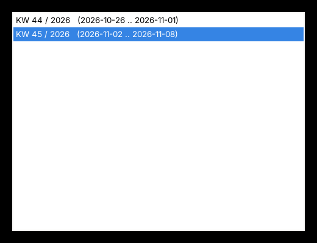

# timeTracker

Schlanke **Arbeitszeit- und Todo-Verwaltung** im Infobereich (Tray) – für **Windows** (PowerShell)
und **Linux** (Python 3 + GTK). Alle Daten liegen in einfachen Dateien (CSV und JSON). Der
Datenordner kann daher über Nextcloud, Syncthing, ein Netzlaufwerk o. ä. zwischen mehreren
Rechnern synchronisiert werden. Beide Varianten verwenden exakt dieselben Dateiformate und können
parallel genutzt werden.

🇬🇧 [English version](README.md)



## Funktionen

- **Arbeitszeit erfassen** mit wenigen Tasten: Kategorie → Unterkategorie → Task → Minuten
  (globale Tastenkürzel `Strg+Alt+Z` Menü, `Strg+Alt+A` Task hinzufügen)
- **Wochen-Worklog** als CSV (`worklogs/<Montag>_worklog.csv`) und zusammengefasster **Wochen-Report**
- **Todos** für Woche / Monat / Jahr / Sonstiges mit **Todo-Report** in Markdown;
  beim Erledigen wird die Zeit ins Worklog gebucht
- **Export** von Wochen-Report (CSV) und Todo-Report (Markdown) als `<Name>_KW<nn>_<Jahr>_…`
  in einen frei wählbaren Ordner
- **Frei konfigurierbare Spalten** für Worklog-CSV/Report und Todo-Report: Reihenfolge ändern,
  Spalten weglassen oder hinzufügen, z. B. *Startzeit*, *Endzeit*, *Wochentag*, *Dauer h:mm*,
  *Benutzer* oder eigene Felder
- Oberfläche auf **Deutsch und Englisch**
- **Sync-sicher**: jede Änderung wird frisch aus der Datei gelesen und sofort geschrieben
  (atomarer Austausch, rotierende Backups); mehrere Rechner überschreiben sich nicht gegenseitig
- Tastaturbedienung: Enter/→ auswählen, Esc/← zurück, F5 aktualisieren

## Schnellstart

| | Windows | Linux (Debian/Ubuntu) |
|---|---|---|
| Voraussetzungen | Windows 10/11, PowerShell 5.1 (vorinstalliert) | `python3`, `python3-gi`, `gir1.2-gtk-3.0`, `gir1.2-ayatanaappindicator3-0.1` (installiert `install.sh`) |
| Dateien | `windows/zeiterfassung.ps1`, `windows/start-zeiterfassung.cmd` | `linux/zeiterfassung.py`, `linux/install.sh` |
| Start | Doppelklick auf `start-zeiterfassung.cmd` | `sh install.sh`, danach `python3 zeiterfassung.py &` |

Die Programmdateien **in den Datenordner** legen (z. B. einen Nextcloud-Ordner) – die Daten
werden neben dem Script gespeichert. Details: [Installationsanleitung](docs/de/installationsanleitung.md) ·
[Benutzerhandbuch](docs/de/benutzerhandbuch.md)

## Dateien im Datenordner

```
<Datenordner>/
├── zeiterfassung.ps1 / zeiterfassung.py
├── categories.json      Kategorien und Unterkategorien
├── tasks.json           Task-Katalog je Kategorie::Unterkategorie
├── todo.json            Todos
├── columns.json         Spalten-Konfiguration (gilt für alle Rechner)
├── backups/             rotierende Backups (.0 = neuestes … .9)
└── worklogs/
    ├── 2026-11-02_worklog.csv
    └── backups/
```

Persönliche Einstellungen (Name, Export-Pfad, Sprache) werden **pro Rechner** gespeichert:
`%APPDATA%\Zeiterfassung\settings.json` (Windows) bzw. `~/.config/zeiterfassung/settings.json` (Linux).

## Lizenz

[MIT](LICENSE) © 2026 mtsonline
