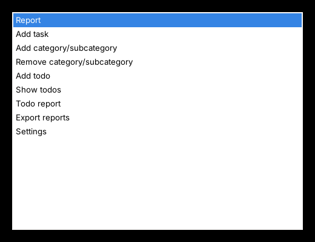

# timeTracker

Lightweight **time and todo tracker** that lives in the system tray – for **Windows** (PowerShell)
and **Linux** (Python 3 + GTK). Everything is stored in plain files (CSV and JSON), so the data
folder can be synchronised between several computers with Nextcloud, Syncthing, a network share
and the like. Both variants use exactly the same file formats and can be used side by side.

🇩🇪 [Deutsche Version](README.de.md)



## Features

- **Log work time** in a few keystrokes: category → subcategory → task → minutes
  (global hotkeys `Ctrl+Alt+Z` menu, `Ctrl+Alt+A` add task)
- **Weekly worklog** as CSV (`worklogs/<monday>_worklog.csv`) and a summarised **weekly report**
- **Todos** per week / month / year / other, with a Markdown **todo report**;
  completing a todo books the time into the worklog
- **Export** of the weekly report (CSV) and the todo report (Markdown) as
  `<name>_KW<nn>_<year>_…` into a folder of your choice
- **Configurable columns** for the worklog CSV/report and the todo report: reorder, remove or add
  columns such as *start time*, *end time*, *weekday*, *duration h:mm*, *user* or your own fields
- **German and English** user interface
- **Sync-safe**: every change is read fresh from disk and written immediately (atomic replace,
  rotating backups), so several computers don't overwrite each other
- Keyboard-friendly: Enter/→ select, Esc/← back, F5 refresh

## Quick start

| | Windows | Linux (Debian/Ubuntu) |
|---|---|---|
| Requirements | Windows 10/11, PowerShell 5.1 (built-in) | `python3`, `python3-gi`, `gir1.2-gtk-3.0`, `gir1.2-ayatanaappindicator3-0.1` (installed by `install.sh`) |
| Files | `windows/zeiterfassung.ps1`, `windows/start-zeiterfassung.cmd` | `linux/zeiterfassung.py`, `linux/install.sh` |
| Start | double-click `start-zeiterfassung.cmd` | `sh install.sh`, then `python3 zeiterfassung.py &` |

Put the program files **into your data folder** (e.g. a Nextcloud folder) – the data is stored
next to the script. Details: [Installation guide](docs/en/install-guide.md) ·
[User guide](docs/en/user-guide.md)

## Data files

```
<data folder>/
├── zeiterfassung.ps1 / zeiterfassung.py
├── categories.json      categories and subcategories
├── tasks.json           task catalogue per category::subcategory
├── todo.json            todos
├── columns.json         column configuration (shared by all computers)
├── backups/             rotating backups (.0 = newest … .9)
└── worklogs/
    ├── 2026-11-02_worklog.csv
    └── backups/
```

Personal settings (user name, export path, language) are stored **per computer**:
`%APPDATA%\Zeiterfassung\settings.json` (Windows) or `~/.config/zeiterfassung/settings.json` (Linux).

Default worklog format (UTF‑8 with BOM, `;`, CRLF):

```
Datum;Projekt oder IT-Service;Tätigkeitskategorie;kurze Tätigkeitsbeschreibung;Aufwand bzw. Dauer
2026-11-03;IT;Server;Patching;45
```

## License

[MIT](LICENSE) © 2026 mtsonline
