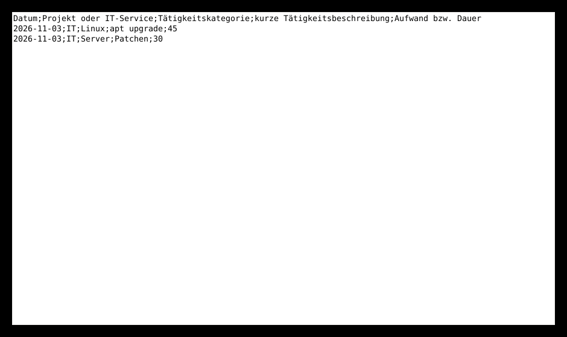
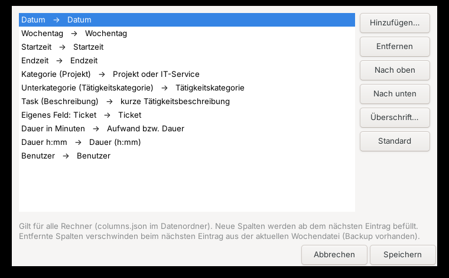

# Benutzerhandbuch

## Überblick

timeTracker läuft im Infobereich (Tray). Ein Klick auf das Symbol oder **Strg+Alt+Z** öffnet das
Menü. Das Symbol zeigt die heute erfasste Zeit (Windows: Tooltip, Linux: Text neben dem Symbol).

| Menüpunkt | Funktion |
|---|---|
| Report | Wochen-Report einer gewählten Woche anzeigen |
| Task hinzufügen | Arbeitszeit buchen |
| Kategorie/Unterkategorie hinzufügen / entfernen | Struktur pflegen |
| Todo hinzufügen / Todos anzeigen / Todo-Report | Todos verwalten |
| Reports exportieren | Wochen-Report und Todo-Report als Dateien speichern |
| Einstellungen | Name, Export-Pfad, Sprache, Spalten |
| Heute neu berechnen | Tagessumme aktualisieren |
| Beenden | Programm schließen (alle Daten sind bereits gespeichert) |

### Tastatur

In allen Listen: **↑/↓** wählen, **Enter** oder **→** bestätigen, **Esc** oder **←** zurück,
Buchstaben tippen springt zum Eintrag. In Report-Fenstern aktualisiert **F5**.
In Eingabefeldern wirkt **←** nur als „zurück“, solange das Feld leer ist.

## Grundbegriffe

- **Kategorie** – z. B. ein Projekt oder IT-Service (CSV-Spalte „Projekt oder IT-Service“)
- **Unterkategorie** – Art der Tätigkeit (CSV-Spalte „Tätigkeitskategorie“)
- **Task** – kurze Beschreibung (CSV-Spalte „kurze Tätigkeitsbeschreibung“). Tasks werden je
  Kategorie/Unterkategorie gemerkt und beim nächsten Mal zur Auswahl angeboten.

## Erste Schritte

1. **Einstellungen** öffnen, Namen, Export-Pfad und Sprache eintragen.
2. **Kategorie/Unterkategorie hinzufügen** → *[Neue Kategorie anlegen]* → Name → Unterkategorie.
3. **Task hinzufügen** (oder **Strg+Alt+A**): Kategorie → Unterkategorie → Task (oder
   *[Neuen Task eingeben]*) → Minuten.

Jeder Eintrag landet sofort in `worklogs/<Montag der Woche>_worklog.csv`.

## Report

**Report** → Woche wählen (die aktuelle Woche ist vorausgewählt; Anzeige `KW 45 / 2026 (2026-11-02 .. 2026-11-08)`).
Einträge mit gleichem Datum, gleicher Kategorie, Unterkategorie und Beschreibung werden summiert.
Der Fenstertitel zeigt die Wochensumme.

## Todos

- **Todo hinzufügen:** Zielgruppe (Woche, Monat, Jahr, Sonstiges) → Kategorie → Unterkategorie →
  Task → Beschreibung (mehrzeilig).
- **Todos anzeigen:** Zielgruppe wählen; Enter öffnet ein Todo. Im Detail-Fenster kann die
  Beschreibung bearbeitet, das Todo in eine andere Zielgruppe **verschoben** oder als **erledigt**
  verbucht werden. Beim Erledigen wird nach den Minuten gefragt und ein Worklog-Eintrag erzeugt.
- **Todo-Report:** offene Todos von Woche, Monat und Jahr als Markdown.

## Reports exportieren

Exportiert für eine gewählte Woche in den Export-Pfad:

- `<Name>_KW<nn>_<Jahr>_Arbeitszeit.csv` – der Wochen-Report
- `<Name>_KW<nn>_<Jahr>_Todos.md` – der Todo-Report (nur Woche, Monat, Jahr)

Bei englischer Oberfläche heißen die Dateien `<Name>_CW<nn>_<Jahr>_Worktime.csv` bzw. `…_Todos.md`.
Vorhandene Dateien derselben Woche werden überschrieben.

## Einstellungen

| Einstellung | Bedeutung | Gespeichert |
|---|---|---|
| Name des Benutzers | für die Export-Dateinamen und die Spalte „Benutzer“ | lokal pro Rechner |
| Export-Pfad | Zielordner für „Reports exportieren“ | lokal pro Rechner |
| Sprache | Deutsch oder Englisch (Oberfläche, Report-Überschriften, Wochentage) | lokal pro Rechner |
| Spalten Worklog / Todo-Report | siehe unten | `columns.json` im Datenordner (für alle Rechner) |

## Spalten konfigurieren

**Einstellungen → Spalten Worklog…** legt fest, welche Spalten die Worklog-CSV, der Report und der
CSV-Export haben – in welcher Reihenfolge und mit welcher Überschrift.

| Feld | Inhalt |
|---|---|
| Datum | `yyyy-MM-dd` (Pflicht) |
| Wochentag | z. B. „Dienstag“ (in der eingestellten Sprache) |
| Startzeit | `HH:MM` – wird beim Buchen abgefragt (Vorschlag: jetzt minus Dauer) |
| Endzeit | `HH:MM` – Startzeit + Dauer |
| Kategorie (Projekt) | Spalte „Projekt oder IT-Service“ |
| Unterkategorie (Tätigkeitskategorie) | Spalte „Tätigkeitskategorie“ |
| Task (Beschreibung) | Spalte „kurze Tätigkeitsbeschreibung“ |
| Dauer in Minuten | Spalte „Aufwand bzw. Dauer“ |
| Dauer h:mm | z. B. `1:30` |
| Benutzer | Name aus den Einstellungen |
| Eigenes Feld | beliebiger Name, z. B. „Ticket“; der Wert wird beim Buchen abgefragt |

Datum und eine Dauer-Spalte (Minuten oder h:mm) sind Pflicht. **Standard** stellt das
ursprüngliche Format wieder her:
`Datum;Projekt oder IT-Service;Tätigkeitskategorie;kurze Tätigkeitsbeschreibung;Aufwand bzw. Dauer`.

Hinweise:

- Ohne gespeicherte Spalten-Konfiguration richten sich die Standard-Überschriften nach der
  Sprache (Englisch: „Date;Project or IT service;…“). Teilen sich Rechner mit unterschiedlicher
  Sprache einen Datenordner, die Spalten einmal speichern – dann gilt `columns.json` für alle.
- Dateien werden beim Lesen über ihre Kopfzeile erkannt. Ältere Wochen bleiben daher lesbar,
  auch wenn sich die Spalten später ändern.
- Beim nächsten Eintrag wird die **aktuelle** Wochendatei im neuen Layout geschrieben. Entfernte
  Spalten verschwinden dabei aus dieser Datei (der vorige Stand liegt in `worklogs/backups`).
- Ist die Startzeit eine Spalte, werden Einträge mit unterschiedlicher Startzeit im Report nicht
  zusammengefasst.

**Einstellungen → Spalten Todo-Report…** legt den Aufbau jeder Todo-Zeile fest:
`* Spalte1 | Spalte2 | …`. Jede Spalte hat ein **Format**, `{value}` steht für den Wert –
z. B. `({value})` für das Datum in Klammern oder `Prio: {value}` für ein eigenes Feld. Verfügbar:
Kategorie->Unterkategorie, Kategorie, Unterkategorie, Task, Beschreibung (1. Zeile), Zielgruppe,
Angelegt (Datum), Id und eigene Felder (werden beim Anlegen eines Todos abgefragt).
Standard: `* Kategorie->Unterkategorie | Task | (Datum)`.

## Mehrere Rechner

- Alle Änderungen werden **vor** jeder Aktion frisch aus den Dateien gelesen und **sofort**
  gespeichert. Beim Beenden wird nichts geschrieben.
- Kann eine Datei nicht gelesen werden (z. B. weil sie gerade synchronisiert wird), erscheint
  eine Meldung und es wird **nichts** gespeichert – es gehen keine Daten verloren.
- Vor jedem Schreiben wird ein Backup angelegt (`backups/<datei>.0` … `.9`).
- Ändern zwei Rechner dieselbe Datei innerhalb weniger Sekunden, bevor synchronisiert wurde, legt
  der Sync-Client u. U. eine Konfliktkopie an (z. B. „… (conflicted copy) …“). Diese bitte
  gelegentlich prüfen.

## Daten wiederherstellen

Programm beenden, gewünschtes Backup aus `backups/` (bzw. `worklogs/backups/`) kopieren, die
Endung `.0`/`.1`/… entfernen und die Originaldatei damit ersetzen.
