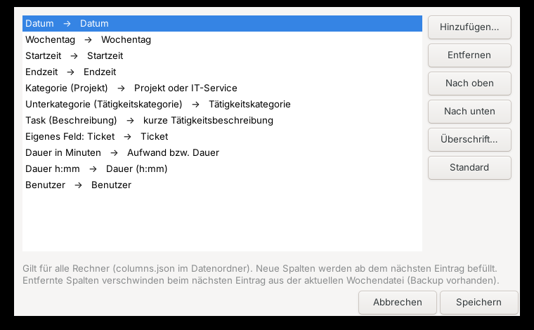

# User guide

## Overview

timeTracker lives in the system tray. Clicking the icon or pressing **Ctrl+Alt+Z** opens the menu.
The icon shows the time logged today (Windows: tooltip, Linux: label next to the icon).

| Menu item | Function |
|---|---|
| Report | show the weekly report of a selected week |
| Add task | log work time |
| Add / remove category/subcategory | maintain the structure |
| Add todo / Show todos / Todo report | manage todos |
| Export reports | save weekly report and todo report as files |
| Settings | user name, export path, language, columns |
| Recalculate today | refresh today's total |
| Exit | close the program (all data is already saved) |

### Keyboard

In all lists: **↑/↓** select, **Enter** or **→** confirm, **Esc** or **←** back, typing letters
jumps to an entry. **F5** refreshes report windows. In input fields **←** only means “back” while
the field is empty.

## Concepts

- **Category** – e.g. a project or IT service (CSV column “Projekt oder IT-Service”)
- **Subcategory** – type of activity (CSV column “Tätigkeitskategorie”)
- **Task** – short description (CSV column “kurze Tätigkeitsbeschreibung”). Tasks are remembered
  per category/subcategory and offered again next time.

The default CSV headers follow the interface language (German: the original format shown in the
README; English: “Date;Project or IT service;Activity category;Short activity description;Effort / duration”).
You can rename them (see *Configuring columns*). If computers with different languages share one
data folder, save the column configuration once – it is then stored in `columns.json` and used by all.

## Getting started

1. Open **Settings** and enter your name, export path and language.
2. **Add category/subcategory** → *[Create new category]* → name → subcategory.
3. **Add task** (or **Ctrl+Alt+A**): category → subcategory → task (or *[Enter new task]*) → minutes.

Every entry is written immediately to `worklogs/<monday of the week>_worklog.csv`.

## Report

**Report** → select a week (the current week is preselected; shown as `CW 45 / 2026 (2026-11-02 .. 2026-11-08)`).
Entries with the same date, category, subcategory and description are summed up. The window
title shows the weekly total.

## Todos

- **Add todo:** scope (week, month, year, other) → category → subcategory → task → description
  (multi-line).
- **Show todos:** select a scope; Enter opens a todo. In the detail window you can edit the
  description, **move** the todo to another scope or mark it as **done**. When marking it done you
  are asked for the minutes and a worklog entry is created.
- **Todo report:** open todos of week, month and year as Markdown.

## Export reports

Exports the selected week into the export path:

- `<name>_CW<nn>_<year>_Worktime.csv` – the weekly report
- `<name>_CW<nn>_<year>_Todos.md` – the todo report (week, month and year only)

With the German interface the files are named `<Name>_KW<nn>_<Jahr>_Arbeitszeit.csv` and `…_Todos.md`.
Existing files of the same week are overwritten.

## Settings

| Setting | Meaning | Stored |
|---|---|---|
| User name | used in export file names and the “User” column | locally per computer |
| Export path | target folder for “Export reports” | locally per computer |
| Language | German or English (interface, report headings, weekdays) | locally per computer |
| Worklog / todo report columns | see below | `columns.json` in the data folder (shared) |

## Configuring columns

**Settings → Worklog columns…** defines which columns the worklog CSV, the report and the CSV
export contain – in which order and with which header.

| Field | Content |
|---|---|
| Date | `yyyy-MM-dd` (required) |
| Weekday | e.g. “Tuesday” (in the selected language) |
| Start time | `HH:MM` – asked for when logging (proposal: now minus duration) |
| End time | `HH:MM` – start time + duration |
| Category (project) | column “Projekt oder IT-Service” |
| Subcategory (activity category) | column “Tätigkeitskategorie” |
| Task (description) | column “kurze Tätigkeitsbeschreibung” |
| Duration in minutes | column “Aufwand bzw. Dauer” |
| Duration h:mm | e.g. `1:30` |
| User | user name from the settings |
| Custom field | any name, e.g. “Ticket”; the value is asked for when logging |

Date and one duration column (minutes or h:mm) are required. **Default** restores the original
format (with English interface: English headers).

Notes:

- Files are recognised by their header line when read, so older weeks remain readable even if
  the columns change later.
- With the next entry the **current** week file is rewritten in the new layout. Removed columns
  disappear from that file (the previous version is kept in `worklogs/backups`).
- If the start time is a column, entries with different start times are not merged in the report.

**Settings → Todo report columns…** defines each todo line: `* column1 | column2 | …`. Every column
has a **format** in which `{value}` stands for the value – e.g. `({value})` for the date in
brackets or `Prio: {value}` for a custom field. Available: Category->Subcategory, Category,
Subcategory, Task, Description (1st line), Scope, Created (date), Id and custom fields (asked for
when creating a todo). Default: `* Category->Subcategory | Task | (date)`.

## Several computers

- Data is read fresh from the files **before** every action and saved **immediately**. Nothing is
  written on exit.
- If a file cannot be read (e.g. while it is being synchronised) you get a message and **nothing**
  is saved – no data is lost.
- A backup is created before every write (`backups/<file>.0` … `.9`).
- If two computers change the same file within a few seconds before it was synchronised, the sync
  client may create a conflict copy (e.g. “… (conflicted copy) …”). Check for these occasionally.

## Restoring data

Exit the program, copy the desired backup from `backups/` (or `worklogs/backups/`), remove the
`.0`/`.1`/… suffix and replace the original file with it.
